 

 

## 👋 Sobre mí

Soy **desarrollador de software full-stack** en Medellín, técnico en Desarrollo de Software (Cesde) y estudiante de **Ingeniería de Software** en el TdeA. Construyo productos de punta a punta: del diseño de la interfaz a la API y la base de datos.

- 💼 Trabajé **7 meses en WeSportech** en aplicaciones para el sector deportivo: gestión de eventos, streaming, usuarios y facturación, en proyectos para la **Liga Antioqueña de Fútbol** y **Los Paisitas**.
- 🚀 Soy fundador de **[Dcodea](https://www.instagram.com/dcod.ea/)**, mi estudio de código y diseño: desarrollo web, software a medida y merch para developers.
- 🤝 Busco mi próximo reto como desarrollador, remoto o en Medellín.

 

## 🛠️ Stack

 

 

| | |
|---|---|
| **Frontend** | Angular · React · TypeScript · HTML5 · CSS3 / SASS |
| **Backend** | Java 17+ · Spring Boot · Hibernate · Node.js · Express · NestJS · APIs REST |
| **Bases de datos** | PostgreSQL · MySQL · Cosmos DB · Modelado de datos |
| **Herramientas** | Git · GitHub · Azure DevOps · Docker · Scrum |

 

## 🚀 Proyectos destacados

<table>
<tr>
<td width="50%" valign="top">

<h3>🍽️ SmartKitchen</h3>

POS para restaurantes: pedidos por mesa, pantallas por estación (cocina, barra) y facturación con propina. Roles con JWT.

<a href="https://duangomez.github.io/SmartKitchen/"><b>Demo</b></a> · <a href="https://github.com/DuanGomez/SmartKitchen"><b>Código</b></a>
</td>
<td width="50%" valign="top">

<h3>🏋️ Trainix</h3>

Gestión de gimnasios: membresías, pagos, caja con cierre, check-in, rutinas y reportes exportables a Excel.

<a href="https://duangomez.github.io/Trainix/"><b>Demo</b></a> · <a href="https://github.com/DuanGomez/Trainix"><b>Código</b></a>
</td>
</tr>
<tr>
<td width="50%" valign="top">

<h3>🛍️ SaaS Ventas</h3>

SaaS multi-tienda: cada negocio tiene su vitrina y panel de administración, con ventas directas por WhatsApp.

<a href="https://duangomez.github.io/SaaS-Ventas/"><b>Demo</b></a> · <a href="https://github.com/DuanGomez/SaaS-Ventas"><b>Código</b></a>
</td>
<td width="50%" valign="top">

<h3>🖋️ Doose Tattoo</h3>

Estudio de tatuajes: portafolio, carrito de servicios y agenda de citas por tatuador. Proyecto en equipo con Scrum.

<a href="https://duangomez.github.io/Doose/"><b>Demo</b></a> · <a href="https://github.com/DuanGomez/Doose"><b>Código</b></a>
</td>
</tr>
</table>

<a href="https://duangomez.github.io/Duan-Portafolio/#proyectos"><b>Ver todos los proyectos en mi portafolio →</b></a>

 

### 💬 ¿Hablamos?

Estoy abierto a oportunidades como desarrollador. Escríbeme a **[duangomez8@gmail.com](mailto:duangomez8@gmail.com)** o por **[WhatsApp](https://wa.me/573232922041)**.

